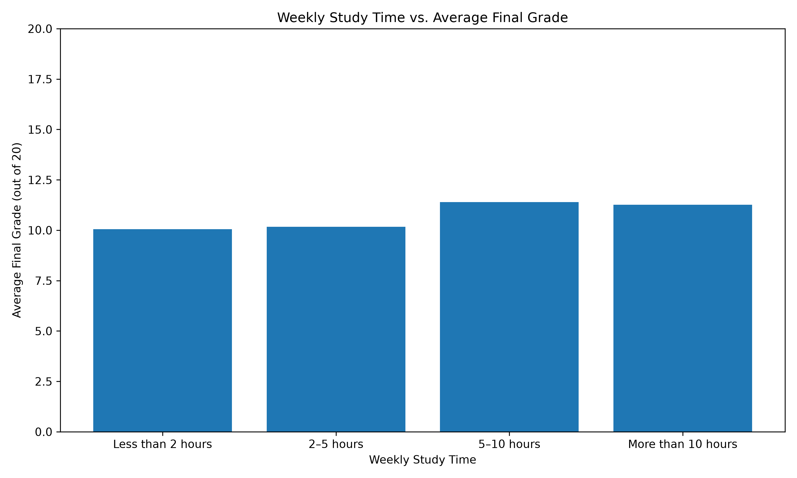

# Student Performance Analysis

## Project Overview

This project explores student academic performance using Python, data analysis, visualization, and introductory machine learning.

The initial research question is:

**How does reported weekly study time relate to students' final grades?**

The project also explores whether selected student characteristics and earlier-period grades can be used to predict final grades.

It demonstrates practical skills in data loading, descriptive statistics, grouping, visualization, regression modelling, and model evaluation.

## Dataset

This project uses the Student Performance dataset from the [UCI Machine Learning Repository](https://archive.ics.uci.edu/dataset/320/student+performance).

The mathematics dataset contains 395 student records and 33 variables.

The dataset is not included in this repository. To reproduce the analysis, obtain the dataset from its original source and review the applicable licence and usage terms.

The Python scripts expect the mathematics dataset to be named `student-mat.csv`. You may need to adjust its location according to the script you want to run.

## Tools and Technologies

- Python 3
- pandas
- NumPy
- Matplotlib
- scikit-learn
- Anaconda
- Visual Studio Code

## Exploratory Data Analysis

The initial analysis included:

- Loading the dataset into a pandas DataFrame.
- Inspecting dataset dimensions, columns, and sample records.
- Checking for missing values.
- Calculating descriptive statistics for final grades.
- Grouping students by reported weekly study time.
- Comparing group sizes, mean grades, and median grades.
- Visualizing average final grades across study-time categories.

### Key Findings

The dataset contains 395 student records and 33 variables. The initial missing-value check found no missing values.

The overall average final grade (`G3`) is approximately 10.42 out of 20, with a median of 11.

Average final grades by study-time category:

| Study-time category     | Students | Average final grade |
| ----------------------- | -------: | ------------------: |
| Less than 2 hours/week  |      105 |               10.05 |
| 2–5 hours/week          |      198 |               10.17 |
| 5–10 hours/week         |       65 |               11.40 |
| More than 10 hours/week |       27 |               11.26 |

The two higher study-time categories have higher average grades than the two lower categories. However, the relationship is not strictly increasing.

These findings indicate an association in this dataset, not proof that additional study time directly causes higher grades.

## Visualization

### Average Grade by Study Time

## Machine Learning: Predicting Final Grades

The project also uses linear regression to predict students' final grades (`G3`).

The data was divided into training and testing sets, using an 80/20 split. Models were evaluated on the test set using:

- **Mean Absolute Error (MAE):** The average absolute difference between actual and predicted grades.
- **Root Mean Squared Error (RMSE):** A metric that gives greater weight to larger prediction errors.

Lower values indicate better performance on these metrics.

### Models Compared

**1. Mean Baseline**

A simple baseline predicts the mean final grade calculated from the training data for every test observation.

**2. Linear Regression — Three Features**

This model uses:

- `studytime`
- `absences`
- `failures`

**3. Linear Regression — Five Features**

This model uses the three original features plus:

- `G1`
- `G2`

The earlier-period grades provide additional information for predicting the final grade when those grades are available.

### Model Evaluation Results

| Model             | Features                               |  MAE | RMSE |
| ----------------- | -------------------------------------- | ---: | ---: |
| Mean Baseline     | Training-set mean                      | 3.65 | 4.55 |
| Linear Regression | Three features                         | 3.56 | 4.46 |
| Linear Regression | Five features, including `G1` and `G2` | 1.34 | 2.11 |

### Interpretation

The initial linear regression model slightly outperformed the mean baseline.

Adding `G1` and `G2` substantially improved performance on the same test split. MAE decreased from 3.56 to 1.34, while RMSE decreased from 4.46 to 2.11.

This suggests that earlier-period grades provide useful predictive information about final grades.

However, the feature set must match the intended prediction scenario. A model using `G1` and `G2` cannot be used to make predictions at the beginning of the school year if those grades are not yet available.

The results are based on a single train/test split. Further evaluation would be needed to establish how consistently the models perform on other data.

## Limitations

- Study time is recorded in categories rather than exact hours.
- The study-time groups have different sample sizes.
- The dataset is observational, so the analysis cannot establish causation.
- The dataset represents students from two Portuguese schools and may not represent other populations.
- Other factors may influence academic performance.
- Model evaluation on a single test split may not fully represent performance on unseen data.
- Linear regression may produce predictions outside the valid grade range.
- Predictive performance depends on which features are available when a prediction is made.

## How to Run

1. Install Python.
2. Obtain this repository.
3. Install the required libraries:

   `python -m pip install -r requirements.txt`

4. Download the mathematics dataset from the UCI Machine Learning Repository and review its usage terms.
5. Place `student-mat.csv` in the location expected by the relevant Python script.
6. Run the exploratory analysis:

   `python analyze_students.py`

To evaluate the machine-learning models, run 'python evaluate-student-performance.py'

## Future Improvements

- Improve the organization and documentation of analysis scripts.
- Investigate prediction errors and model limitations.
- Explore appropriate model validation methods.
- Continue developing reproducible data analysis and machine-learning workflows.
